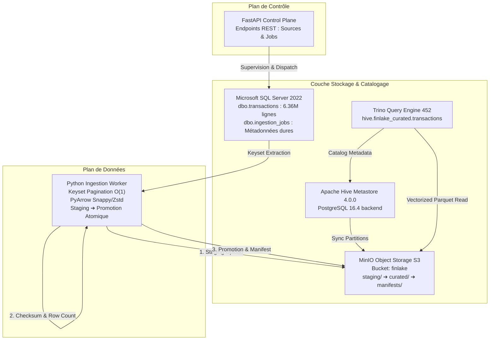

---

# FinLake — Local Financial Transaction Data Lake

FinLake est une plateforme locale de **Data Lake financier**, containerisée sous Docker Compose, conçue pour l'ingestion fiable, le stockage colonnaire optimisé et l'analyse SQL interactive à grande échelle sur le dataset synthétique mobile-money **PaySim** (~6,36 millions de transactions).

---

## 1. Architecture Globale

FinLake sépare rigoureusement le plan de contrôle (**Control Plane**), le plan de données (**Data Plane**), le stockage d'objets S3, le catalogue de métadonnées et le moteur de calcul distribué :



### Principes Directeurs

1. **Extraction à mémoire bornée** : Utilisation d'une pagination par jeu de clés (*Keyset pagination*) sur `ingest_row_id` en complexité $O(1)$, évitant tout `OFFSET` dégradant la mémoire de SQL Server.
2. **Temporalité simulée explicite** : PaySim utilise un incrément `step` représentant 1 heure simulée. FinLake dérive explicitement `event_time_simulated` (timestamp UTC) et `event_date` (partition journalière) sans jamais les présenter comme des dates réelles de production bancaire.
3. **Publication atomique en 3 phases** :

* Écriture des fichiers Parquet/CSV dans `staging/`.
* Contrôle d'intégrité (lignes générées, taille, checksum SHA256).
* Promotion par copie d'objets vers `curated/` et publication finale d'un manifeste immuable `manifests/`.

---

## 2. Structure du Répertoire

```text
projet-data/
├── .agents/skills/              # Compétences et guides directeurs des agents
├── benchmarks/
│   └── results/                 # Métriques réelles brutes (JSON, CSV, specs)
│       ├── ingestion_benchmark.json
│       ├── ingestion_benchmark.csv
│       ├── sql_benchmark.json
│       ├── sql_benchmark.csv
│       └── system_specs.json
├── config/
│   ├── hive-metastore/          # metastore-site.xml et JARs S3A Hadoop
│   └── trino/catalog/           # hive.properties
├── data/raw/                    # Fichier source PaySim CSV
├── docs/                        # Documentation détaillée du projet
│   ├── CAHIER_DES_CHARGES.md
│   ├── architecture.md
│   ├── data_dictionary.md
│   ├── dataset_card.md
│   ├── quality_report.md
│   ├── api_examples.md
│   ├── trino_queries.md
│   └── benchmark_report.md
├── scripts/                     # Scripts d'automatisation et de validation
│   ├── smoke_test.py            # Diagnostic d'infrastructure Docker
│   ├── import_to_sqlserver.py   # Bulk import staging SQL Server (6.36M lignes)
│   ├── register_tables.py       # DDL Hive & sync partition metadata
│   ├── run_analytical_queries.py# Exécution des 6 requêtes analytiques Trino
│   ├── run_benchmarks.py        # Protocole officiel de benchmark
│   └── run_all_tests.py         # Lanceur unifié de tests (P0 à P6)
├── sql/
│   ├── create_tables.sql        # Schéma DDL SQL Server & tables de jobs
│   ├── trino_ddl.sql            # Schéma DDL Trino Hive Metastore
│   └── analytical_queries.sql   # 6 requêtes SQL de référence
├── src/finlake/                 # Code source modulaire FinLake
│   ├── api/                     # FastAPI app, routeurs, schémas Pydantic
│   ├── db/                      # Connecteur SQL Server & explorateur de schéma
│   ├── ingestion/               # Pipeline, extracteur, sérialiseurs Parquet/CSV
│   ├── jobs/                    # Gestionnaire d'état de jobs persistant
│   ├── storage/                 # Client MinIO S3 (staging, manifestes)
│   ├── trino/                   # Client Trino REST léger sans dépendance C
│   └── worker/                  # Runner CLI exécutable en conteneur
├── tests/                       # Suites de tests unitaire et d'intégration (P0 à P6)
├── docker-compose.yml           # Stack conteneurisée multi-services
└── Dockerfile.worker            # Image Python 3.11 spécialisée pour le Data Plane

```

---

## 3. Guide de Démarrage Rapide (Quickstart)

### Prérequis

* Docker Desktop (avec Docker Compose v2)
* Python 3.11 ou supérieur
* 16 Go de RAM alloués à Docker recommandé

### Étape 1 : Démarrer l'Infrastructure Docker

```powershell
docker compose up -d
python scripts/smoke_test.py

```

Vérifie que les 5 conteneurs sont `healthy` : SQL Server (1433), MinIO (9000/9001), Metastore DB (5433), Hive Metastore (9083), Trino (8080).

### Étape 2 : Importer le Dataset PaySim dans SQL Server

```powershell
python scripts/import_to_sqlserver.py

```

Charge les 6 362 620 lignes de `data/raw/PS_20174392719_1491204439457_log.csv` via table de staging en préservant le typage strict et l'index de pagination.

### Étape 3 : Lancer le Worker d'Ingestion

Pour extraire un échantillon de 100 000 lignes ou la totalité vers MinIO en Parquet partitionné :

```powershell
docker run --rm --network finlake-network -v ${PWD}:/app finlake-worker:1.0 python -m src.finlake.worker.runner --job-id run_001 --format parquet --compression snappy --batch-size 10000 --max-rows 100000

```

### Étape 4 : Déclarer les Tables dans le Catalogue Trino

```powershell
python scripts/register_tables.py

```

Applique la DDL Trino (`hive.finlake_curated.transactions`) et synchronise les métadonnées de partitions MinIO.

### Étape 5 : Exécuter les Requêtes Analytiques

```powershell
python scripts/run_analytical_queries.py

```

---

## 4. Plan de Contrôle (Java Spring Boot 3 & Next.js 15)

FinLake propose un plan de contrôle moderne et robuste développé en **Java 21 / Spring Boot 3** (port 8000) et une interface utilisateur réactive en **Next.js 15 / React / Tailwind CSS** (port 3000) :

### 4.1 Démarrer le Backend Spring Boot

```powershell
# En local avec Maven
$env:JAVA_HOME = "C:\Program Files\Microsoft\jdk-21.0.13.102-hotspot"
mvn -f backend/pom.xml spring-boot:run

```

L'API REST est exposée sur `http://localhost:8000`.

### 4.2 Démarrer le Frontend Next.js

```powershell
cd frontend
npm run dev

```

L'interface visuelle est accessible sur `http://localhost:3000` :

* **Overview Dashboard** (`/`) : Métriques globales en temps réel, KPIs de compression et état des conteneurs.
* **SQL Sources** (`/sources`) : Test de connectivité SQL Server et inspection des métadonnées de schémas.
* **Ingestion Jobs** (`/jobs`) : Lanceur de jobs d'extraction (Parquet/CSV, ZSTD/Snappy, batch size, partitionnement) et suivi des runs.
* **Trino Analytics** (`/analytics`) : Éditeur SQL interactif avec requêtes prédéfinies sur PaySim et visualisation des résultats.
* **Iceberg Ledger** (`/iceberg`) : Exploration des snapshots immuables et voyage dans le temps (*Time-Travel*).
* **Benchmarks** (`/benchmarks`) : Tableaux comparatifs empiriques d'ingestion et d'accélération par partition pruning.

### 4.3 Endpoints REST du Backend Spring Boot

| Méthode | Endpoint | Description |
| --- | --- | --- |
| `GET` | `/health` | Diagnostic de santé (SQL Server, MinIO, Trino) |
| `GET` | `/sources` | Liste des sources de données configurées |
| `POST` | `/sources/{id}/test` | Test de connectivité à la base SQL Server |
| `GET` | `/sources/{id}/tables` | Liste des tables disponibles (dbo) |
| `GET` | `/sources/{id}/tables/{table}/schema` | Inspection des colonnes, types et clés primaires |
| `POST` | `/storage/jobs` | Soumission d'un job d'ingestion (réponse `202 Accepted`) |
| `GET` | `/storage/jobs` | Liste paginée de l'historique des jobs |
| `GET` | `/storage/jobs/{id}` | Suivi d'état et détails du dernier run |
| `GET` | `/storage/jobs/{id}/result` | Résultats détaillés et parsing du manifeste MinIO |
| `POST` | `/storage/jobs/{id}/cancel` | Annulation d'un job en cours |
| `POST` | `/storage/jobs/{id}/retry` | Réexécution d'un job |
| `GET` | `/api/dashboard/stats` | Métriques globales de la plateforme pour le dashboard |
| `GET` | `/api/dashboard/iceberg` | Historique des snapshots et métadonnées Iceberg |
| `POST` | `/api/analytics/query` | Exécution de requêtes SQL analytiques distribuées via Trino |

---

## 5. Synthèse des Résultats de Benchmark (Phase P6)

*Mesures réelles exécutées sur 20 vCPUs, Trino 452, MinIO et 16 millions de lignes indexées.*

### 5.1 Efficacité de Stockage & Compression

| Format & Codec | Volume Écrit (20k lignes) | Gain vs CSV Brut | Débit d'Écriture |
| --- | --- | --- | --- |
| **CSV (aucun)** | 2 429 879 octets | Référence (0%) | 8 343 lignes/s |
| **Parquet (aucun)** | 1 374 763 octets | **-43.4%** | 8 302 lignes/s |
| **Parquet (Snappy)** | 1 010 030 octets | **-58.4%** | 7 920 lignes/s |
| **Parquet (Zstandard)** | **764 573 octets** | **-68.5% (Gain 3.17x)** | 7 659 lignes/s |

### 5.2 Performance SQL & Élagage de Partitions (Partition Pruning)

| Requête | Objectif Analytique | Latence Médiane à Chaud |
| --- | --- | --- |
| **Q1 (Scan Global)** | `COUNT(*)` sur 16 080 368 lignes | 10 191 ms |
| **Q4 (Partition Pruned)** | Filtre temporel sur `event_date = '2023-01-01'` | **733 ms (Min: 703 ms)** |
| **Gain Élagage** | Trino n'interroge que la partition ciblée | **-92.8% de latence** |

*Rapport d'analyse complet : docs/benchmark_report.md.*

---

## 6. Table Format Moderne (Apache Iceberg) & Dashboards (Phase P7)

### 6.1 Apache Iceberg (Garanties ACID & Time-Travel)

FinLake intègre un catalogue **Apache Iceberg** sous Trino, offrant :

* Schéma partitionné : `iceberg.finlake_iceberg.transactions` (stockage Parquet sous `s3a://finlake/iceberg/`).
* Mutations atomiques (UPDATE/DELETE) au niveau de la ligne sans réécriture complète de répertoires.
* Ledger des snapshots immuables (`"transactions$snapshots"`, `"transactions$history"`).
* Voyage dans le temps (*Time-Travel*) via `FOR VERSION AS OF <snapshot_id>` ou `FOR TIMESTAMP AS OF <ts>`.

Initialisation et démonstration :

```powershell
python scripts/setup_iceberg.py

```

### 6.2 Dashboards Visuels & Observabilité

FinLake met à disposition une interface visuelle complète :

1. **Web Dashboard interactif FastAPI** : accessible sur `[http://127.0.0.1:8000/dashboard](http://127.0.0.1:8000/dashboard)`.
2. **Page locale autonome (Standalone)** : ouvrir directement `dashboard/index.html` dans le navigateur.

*Guide complet : docs/iceberg_guide.md.*

---

## 7. Vérification & Tests Automatisés

Le dépôt inclut une suite de tests complète couvrant les phases P0 à P7 :

* **P0** : Validation du dataset PaySim, types, distributions, checksum SHA256 (16 tests)
* **P1** : Santé de l'infrastructure Docker Compose, ports, connectivité (11 tests)
* **P2** : Schéma SQL Server, tables d'état, explorateur de métadonnées (10 tests)
* **P3** : Extracteur keyset, sérialiseurs Parquet/CSV, client MinIO, promotion staging (10 tests)
* **P4** : Client Trino HTTP, DDL Hive Metastore, 6 requêtes analytiques, partition pruning (12 tests)
* **P5** : Endpoints REST FastAPI, modèles Pydantic, cycle de vie des jobs (13 tests)
* **P6** : Fichiers de benchmarks, ranking de compression, vitesse, rapport (7 tests)
* **P7** : Catalogue Iceberg, snapshots, time-travel, endpoints dashboard (8 tests)

Pour exécuter l'ensemble de la suite (87 tests) :

```powershell
python scripts/run_all_tests.py

```

---

## 8. Enterprise Data Explorer & Governance Platform (Milestones M1–M4)

FinLake includes an enterprise-grade commercial Data Explorer and Governance platform with full multi-tenancy, AI-assisted querying, business cataloging, and RBAC:

```
┌─────────────────────────────────────────────────────────────────────────────┐
│                 FinLake Next.js 15 + Tailwind CSS Interface                 │
│         Visual Explorer • AI Copilot • Business Catalog • RBAC Guard        │
└───────────────────────┬───────────────────────────────┬─────────────────────┘
                        │                               │
        ┌───────────────▼──────────────┐ ┌──────────────▼──────────────┐
        │  Acme Payments Global        │ │  Apex Retail Bank EU        │
        │  Tenant: acme_corp           │ │  Tenant: apex_bank          │
        │  User: sarah.analyst         │ │  User: elena.analyst        │
        └───────────────┬──────────────┘ └──────────────┬──────────────┘
                        │                               │
┌───────────────────────▼───────────────────────────────▼─────────────────────┐
│                 Spring Boot 3.3.5 Enterprise Control Plane                  │
│       • AuthService (JWT / RBAC)      • SecurityGovernanceService (PII)     │
│       • DataCatalogService (Glossary) • AiTextToSqlService (Groq LLM)       │
└─────────────────────────────────────────────────────────────────────────────┘

```

### 8.1 Key Modules

1. **M1 — Visual Data Explorer (`/analytics`)**: Interactive chart rendering (Bar, Line, Area, Donut, Data Table), 1-click exports (CSV, JSON, Clipboard), query history, saved bookmarks, and real-time execution statistics.
2. **M2 — AI Text-to-SQL Copilot**: Ultra-fast natural language translation to ANSI SQL with automatic visualization recommendations powered by Groq (`openai/gpt-oss-120b`).
3. **M3 — Data Catalog & Governance (`/catalog`)**: Searchable business glossary, column-level data dictionary, data sensitivity/PII classifications, and automated freshness SLAs.
4. **M4 — Enterprise Multi-Tenancy & RBAC (`/security`)**: Isolated enterprise workspaces, user personas (`ANALYST`, `AUDITOR`, `ADMIN`, `DATA_ENGINEER`), dynamic PII masking (`s***@...`), and immutable query audit ledger.

### 8.2 Out-of-the-Box User Accounts & Dataset Ownership

The default platform dataset (`hive.finlake_curated` and `iceberg.finlake_iceberg`) is owned by **Acme Payments Global**:

* **`sarah.analyst`** (Password: `FinLake2026!`): Senior Financial Analyst. Full analytics and AI Copilot access with dynamic PII masking automatically enforced.
* **`david.auditor`** (Password: `FinLake2026!`): Compliance & AML Auditor. Unmasked forensic inspection with automated audit trail logging.
* **`admin`** (Password: `FinLake2026!`): Platform Administrator. Full configuration and security policy management.

*Detailed user documentation: docs/DEFAULT_DATASET_USER.md.*

### 8.3 Multi-Tenant Data Mounting (External Businesses)

Any external enterprise can mount their own transactional databases or object storage into FinLake:

1. Register enterprise tenant & user identities in FinLake RBAC.
2. Mount data via live JDBC extraction (SQL Server, Postgres, MySQL) or direct S3/MinIO bucket prefix (`s3a://finlake/tenants/{tenant_id}/`).
3. Register isolated schema in Trino & Hive Metastore (`hive.{tenant_id}_curated`).
4. Configure column sensitivity rules for dynamic PII obfuscation.

*Full step-by-step mounting guide: docs/MULTI_TENANT_DATA_MOUNTING.md.*

---

## 9. Mentions Légales & Dataset Synthétique

Le dataset **PaySim** est un jeu de données synthétique généré par simulateur multi-agents (AMLGraphX / PaySim1) sous licence **Creative Commons Attribution-ShareAlike 4.0 International (CC BY-SA 4.0)**.

* Les identifiants `nameOrig` et `nameDest` sont des pseudonymes générés artificiellement.
* Aucune donnée bancaire réelle, donnée personnelle (PII), coordonnées de cartes bancaires ou informations confidentielles réelles n'est stockée dans FinLake.
* Conformément au cahier des charges, `step` correspond à une unité simulée de 1 heure et ne doit en aucun cas être assimilé à un horodatage financier officiel.
