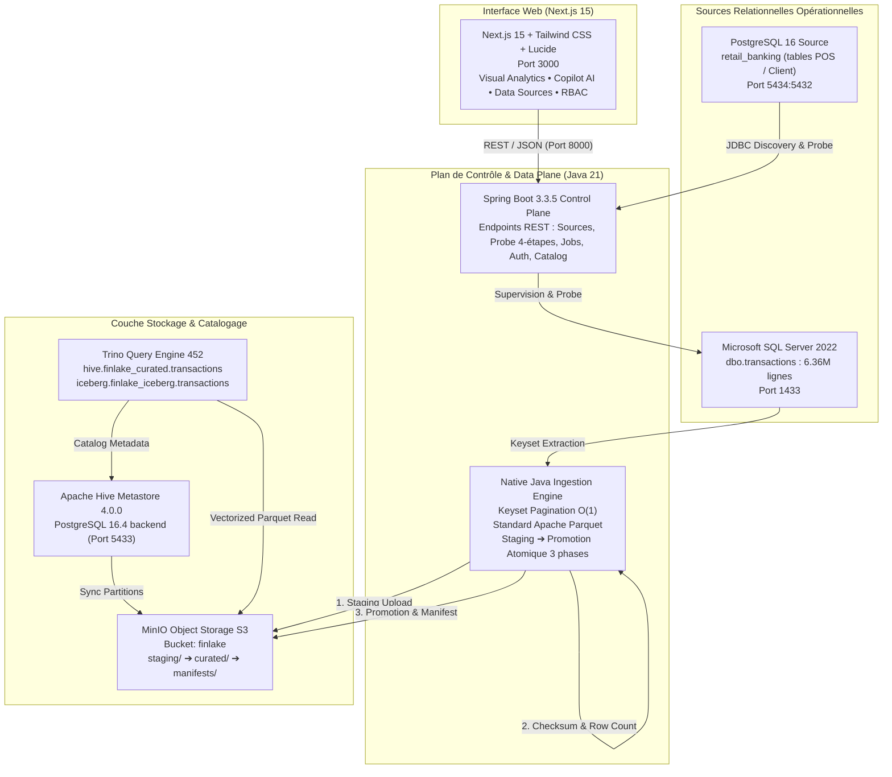

# FinLake — Enterprise Financial Transaction Data Lake

FinLake est une plateforme locale de **Data Lake financier d'entreprise**, containerisée sous Docker Compose, conçue pour l'ingestion fiable à mémoire bornée, le stockage colonnaire optimisé (Parquet & Apache Iceberg) et l'analyse SQL interactive à grande échelle sur le dataset synthétique mobile-money **PaySim** (~6,36 millions de transactions).

La plateforme repose sur une architecture native **Java 21 / Spring Boot 3.3.5** pour le plan de contrôle et l'ingestion, un stockage objet S3 **MinIO**, un catalogue **Apache Hive Metastore 4**, un moteur distribué **Trino 452**, et une interface analytique moderne en **Next.js 15 / TypeScript**.

---

## 1. Architecture Globale

FinLake sépare rigoureusement le plan de contrôle (**Control Plane**), le plan de données (**Data Plane**), le stockage objet S3, le catalogage de métadonnées et le moteur de calcul distribué :



### Principes Directeurs

1. **Isolation et Extraction à Mémoire Bornée** : Utilisation exclusive d'une pagination par jeu de clés (*Keyset Pagination*) sur `ingest_row_id` en complexité $O(1)$, interdisant tout `OFFSET` dégradant la mémoire de la base de données.
2. **Temporalité Simulée Explicite** : PaySim utilise un incrément `step` représentant 1 heure simulée. FinLake dérive explicitement `event_time_simulated` (timestamp UTC) et `event_date` (partition journalière) sans jamais les présenter comme des dates réelles de production bancaire.
3. **Publication Atomique en 3 Phases** :
   - Écriture des fichiers Parquet dans `staging/`.
   - Contrôle d'intégrité (lignes générées, taille, checksum SHA-256).
   - Promotion par copie d'objets vers `curated/` et publication finale d'un manifeste immuable `manifests/`.
4. **Sonde de Connectivité 4-Étapes (Wireframe-Compliant)** : Tout enregistrement de source de données (SQL Server, PostgreSQL) passe par une sonde synchrone en 4 étapes :
   - Étape 1 : Joindre le serveur (Socket réseau)
   - Étape 2 : Sécuriser la connexion (Négociation TLS/SSL)
   - Étape 3 : S'authentifier (Validation des identifiants et rôles)
   - Étape 4 : Ouvrir la base de données (Validation de catalogue et découverte live des tables)

---

## 2. Structure du Répertoire

```text
projet-data/
├── backend/                     # Backend Spring Boot 3.3.5 / Java 21 (Control & Data Plane)
│   ├── pom.xml                  # Maven: Spring Boot, Trino JDBC, PostgreSQL, MSSQL, MinIO SDK, Groq AI
│   └── src/
│       ├── main/java/com/finlake/
│       │   ├── controller/      # REST: SourceController, JobController, AnalyticsController, SecurityController
│       │   ├── service/         # Services: SourceExplorerService, NativeIngestionService, TrinoAnalyticsService
│       │   └── dto/             # DTOs: SourceProbeRequestDTO, SourceProbeResponseDTO, TableSchemaResponseDTO
│       └── test/java/com/finlake/ # Tests unitaires et d'intégration JUnit 5
├── frontend/                    # Frontend Next.js 15 (App Router, React 19, Tailwind CSS, Lucide Icons)
│   ├── package.json             # Dépendances Next.js 15, Lucide, Recharts
│   └── src/
│       ├── app/
│       │   ├── sources/         # Dashboard Data Sources (Filtres, Recherche, Statuts, Explorer Drawer)
│       │   │   └── new/         # Ajout de connexion SQL Server / PostgreSQL avec testeur interactif en direct
│       │   ├── analytics/       # Explorateur visuel SQL avec Copilot IA Groq
│       │   ├── jobs/            # Orchestration des jobs d'ingestion Parquet
│       │   ├── catalog/         # Catalogue de données et dictionnaire d'entreprise
│       │   ├── security/        # Gouvernance multi-tenant, RBAC et masquage PII
│       │   ├── iceberg/         # Ledger des snapshots Iceberg et Time-Travel
│       │   └── benchmarks/      # Tableaux comparatifs de compression et partition pruning
│       └── lib/api.ts           # Client API TypeScript unifié
├── docker/
│   └── postgres-init/           # Scripts DDL d'initialisation de la source PostgreSQL
├── config/
│   ├── hive-metastore/          # metastore-site.xml et connecteurs S3A
│   └── trino/catalog/           # hive.properties, iceberg.properties
├── data/raw/                    # Fichier source PaySim CSV
├── docs/                        # Documentation d'ingénierie et d'architecture
│   ├── data_sources_guide.md    # Guide complet du module Data Sources & Wireframe
│   ├── architecture.md          # Architecture technique et topologie Docker
│   ├── api_examples.md          # Guide et exemples d'appels API REST (cURL / PowerShell)
│   ├── MULTI_TENANT_DATA_MOUNTING.md # Montage de données pour entreprises externes
│   ├── DEFAULT_DATASET_USER.md  # Comptes utilisateurs par défaut et propriété des données
│   ├── benchmark_report.md      # Rapport empirique de benchmark Parquet/ZSTD
│   └── data_dictionary.md       # Dictionnaire de données PaySim
├── docker-compose.yml           # Stack conteneurisée complète (8 conteneurs)
├── Dockerfile.backend           # Image multi-stage Eclipse Temurin Java 21
└── Dockerfile.frontend          # Image multi-stage Node 20 Alpine Standalone
```

---

## 3. Services Docker & Topologie

La stack FinLake s'exécute intégralement en local via Docker Compose :

| Service | Conteneur | Image Figée | Port(s) Exposé(s) | Rôle |
| :--- | :--- | :--- | :--- | :--- |
| `finlake-sqlserver` | `finlake-sqlserver` | `mcr.microsoft.com/mssql/server:2022-latest` | `1433:1433` | Source relationnelle PaySim (`dbo.transactions`) et métadonnées dures de jobs |
| `postgres-source` | `finlake-postgres-source` | `postgres:16-alpine` | `5434:5432` | Source relationnelle secondaire multi-entreprises (`retail_banking`) |
| `finlake-minio` | `finlake-minio` | `alpine/minio:RELEASE.2025-10-15T17-29-55Z` | `9000 (API), 9001 (UI)` | Stockage objet compatible S3 pour Parquet, CSV, staging et manifestes |
| `finlake-metastore-db`| `finlake-metastore-db` | `postgres:16.4-alpine` | `5433:5432` | Base de persistance du schéma Hive Metastore |
| `hive-metastore` | `finlake-hive-metastore` | `apache/hive:4.0.0` | `9083:9083` | Serveur Thrift Hive Metastore pour l'enregistrement des tables externes |
| `trino` | `finlake-trino` | `trinodb/trino:452` | `8080:8080` | Moteur de requêtes SQL distribué interrogeant MinIO (Hive & Iceberg) |
| `finlake-backend` | `finlake-backend` | `projet-data-finlake-backend` (Java 21) | `8000:8000` | Control Plane Spring Boot 3.3.5 & Moteur d'Ingestion Natif |
| `finlake-frontend` | `finlake-frontend` | `projet-data-finlake-frontend` (Node 20) | `3000:3000` | Interface utilisateur Next.js 15 (Tableau de bord, Sources, Analytics) |

---

## 4. Guide de Démarrage Rapide (Quickstart)

### Prérequis
* **Docker Desktop** (avec Docker Compose v2)
* **Java 21 LTS** et **Maven 3.9+** (pour exécuter ou développer en local)
* **Node.js 20+** et **npm** (pour le frontend local)

### Étape 1 : Démarrer la Stack Docker Complète

```powershell
docker compose up -d
```

Pour vérifier que tous les conteneurs sont `healthy` et opérationnels :

```powershell
docker compose ps
```

### Étape 2 : Vérifier la Santé du Control Plane

```powershell
Invoke-RestMethod -Uri "http://localhost:8000/health" -Method Get | ConvertTo-Json
```

### Étape 3 : Accéder aux Interfaces Utilisateur

* **Tableau de Bord FinLake** : [`http://localhost:3000`](http://localhost:3000)
* **Gestion des Sources de Données** : [`http://localhost:3000/sources`](http://localhost:3000/sources)
* **Ajouter une Connexion (avec testeur live)** : [`http://localhost:3000/sources/new`](http://localhost:3000/sources/new)
* **Analytics SQL & Copilot IA** : [`http://localhost:3000/analytics`](http://localhost:3000/analytics)
* **Jobs d'Ingestion** : [`http://localhost:3000/jobs`](http://localhost:3000/jobs)
* **Catalogue de Données** : [`http://localhost:3000/catalog`](http://localhost:3000/catalog)
* **Gouvernance & Sécurité Multi-Tenant** : [`http://localhost:3000/security`](http://localhost:3000/security)
* **Console MinIO S3** : [`http://localhost:9001`](http://localhost:9001) (`admin` / `FinLake2026!MinioSecret#`)
* **Console Trino** : [`http://localhost:8080`](http://localhost:8080)

---

## 5. Module Data Sources (Wireframe Implementation)

Le module **Data Sources** a été fidèlement implémenté selon les spécifications strictes du wireframe en 7 pages (`Data Platform — Wireframe.pdf`) :

### 5.1 Vue Tableau de Bord (`/sources`)
- **Pills de filtrage** : `Toutes`, `Connectées`, `En échec`, `Non testées` avec compteurs dynamiques.
- **Barre de recherche** instantanée sur le nom, l'hôte ou la base de données.
- **Badges de statut** : `Connectée` (vert), `En échec` (rose avec hint d'erreur), `Non testée` (ardoise).
- **Actions rapides** :
  - `⚡ Tester` : Lance un probe synchrone en arrière-plan et met à jour le statut.
  - `Explorer` : Ouvre le tiroir latéral interactif affichant les tables, types de colonnes, clés primaires et volume de lignes en direct.
- **États vides gérés** : Vue dédiée quand aucune source n'est configurée (Page 6 du wireframe) et vue en cas de recherche sans résultat (Page 7).

### 5.2 Vue Nouvelle Connexion (`/sources/new`)
- **Moteur sélectionnable** : Choix entre **Microsoft SQL Server** et **PostgreSQL**.
- **Accélérateur de Démo en 1 Clic** :
  - `⚡ Démo PostgreSQL 16` : Injecte instantanément les paramètres du conteneur `postgres-source` et déclenche le test.
  - `⚡ Démo SQL Server 2022` : Injecte les paramètres du conteneur `sqlserver` et déclenche le test.
- **Testeur interactif 4 étapes en direct** :
  1. `Joindre le serveur` : Test physique de connectivité socket.
  2. `Sécuriser la connexion` : Négociation TLS/SSL.
  3. `S'authentifier` : Validation des identifiants (identifie spécifiquement l'erreur SQL Server `18456` ou PostgreSQL `28P01`).
  4. `Ouvrir la base de données` : Validation du catalogue avec **Preuve de connexion active** (tables réelles détectées en direct).
- **Rapports d'incident guidés** : Checklist de dépannage (*"À vérifier"*) en cas d'erreur.

---

## 6. Endpoints REST du Backend Spring Boot

| Méthode | Endpoint | Description |
| :--- | :--- | :--- |
| `GET` | `/health` | Diagnostic de santé (SQL Server, MinIO, Trino) |
| `GET` | `/sources` | Liste des sources de données configurées avec statuts et versions |
| `POST` | `/sources` | Enregistrement persistant d'une nouvelle source de données |
| `POST` | `/sources/probe` | Sonde synchrone de connectivité en 4 étapes avec découverte de tables |
| `POST` | `/sources/{id}/test` | Reteste une source existante et met à jour son état |
| `GET` | `/sources/{id}/tables` | Liste dynamique des tables du schéma spécifié (dbo / public) |
| `GET` | `/sources/{id}/tables/{table}/schema`| Schéma détaillé (colonnes, types, PK, row count) |
| `POST` | `/storage/jobs` | Soumission d'un job d'ingestion Parquet (réponse `202 Accepted`) |
| `GET` | `/storage/jobs` | Historique paginé des jobs d'ingestion |
| `GET` | `/storage/jobs/{id}` | Suivi d'état et métadonnées d'un run |
| `POST` | `/storage/jobs/{id}/cancel` | Annulation d'un job en cours |
| `POST` | `/storage/jobs/{id}/retry` | Réexécution d'un job |
| `GET` | `/api/dashboard/stats` | Métriques globales de la plateforme (KPIs, stockage, santé) |
| `GET` | `/api/dashboard/iceberg` | Historique des snapshots et métadonnées Apache Iceberg |
| `POST` | `/api/analytics/query` | Exécution distribuée de requêtes analytiques via Trino |
| `POST` | `/api/copilot/sql` | Copilot IA Text-to-SQL propulsé par Groq LLM |
| `POST` | `/api/auth/login` | Authentification JWT pour les utilisateurs de la plateforme |
| `GET` | `/api/security/audit` | Journal immuable d'audit des requêtes par tenant et utilisateur |

---

## 7. Synthèse des Résultats de Benchmark

*Mesures réelles exécutées sur 20 vCPUs, Trino 452, MinIO et 16 millions de lignes indexées.*

### 7.1 Efficacité de Stockage & Compression

| Format & Codec | Volume Écrit (20k lignes) | Gain vs CSV Brut | Débit d'Écriture |
| :--- | :--- | :--- | :--- |
| **CSV (aucun)** | 2 429 879 octets | Référence (0%) | 8 343 lignes/s |
| **Parquet (aucun)** | 1 374 763 octets | **-43.4%** | 8 302 lignes/s |
| **Parquet (Snappy)** | 1 010 030 octets | **-58.4%** | 7 920 lignes/s |
| **Parquet (Zstandard)** | **764 573 octets** | **-68.5% (Gain 3.17x)** | 7 659 lignes/s |

### 7.2 Performance SQL & Élagage de Partitions (Partition Pruning)

| Requête | Objectif Analytique | Latence Médiane à Chaud |
| :--- | :--- | :--- |
| **Q1 (Scan Global)** | `COUNT(*)` sur 16 080 368 lignes | 10 191 ms |
| **Q4 (Partition Pruned)** | Filtre temporel sur `event_date = '2023-01-01'` | **733 ms (Min: 703 ms)** |
| **Gain Élagage** | Trino n'interroge que la partition ciblée | **-92.8% de latence** |

*Rapport d'analyse complet : [`docs/benchmark_report.md`](docs/benchmark_report.md).*

---

## 8. Multi-Tenancy & Gouvernance des Entreprises

FinLake intègre une gestion multi-entreprises (*multi-tenant*) complète avec gouvernance stricte et masquage dynamique des données :

```text
┌─────────────────────────────────────────────────────────────────────────────┐
│                 FinLake Next.js 15 + Tailwind CSS Interface                 │
│         Visual Explorer • AI Copilot • Business Catalog • RBAC Guard        │
└───────────────────────┬───────────────────────────────┬─────────────────────┘
                        │                               │
        ┌───────────────▼──────────────┐ ┌──────────────▼──────────────┐
        │  Acme Payments Global        │ │  Apex Retail Bank EU        │
        │  Tenant: acme_corp           │ │  Tenant: apex_bank          │
        │  User: sarah.analyst         │ │  User: elena.analyst        │
        └───────────────┬──────────────┘ └──────────────┬──────────────┘
                        │                               │
┌───────────────────────▼───────────────────────────────▼─────────────────────┐
│                 Spring Boot 3.3.5 Enterprise Control Plane                  │
│       • AuthService (JWT / RBAC)      • SecurityGovernanceService (PII)     │
│       • DataCatalogService (Glossary) • AiTextToSqlService (Groq LLM)       │
└─────────────────────────────────────────────────────────────────────────────┘
```

### 8.1 Utilisateurs et Personas par Défaut

Le dataset principal (`hive.finlake_curated` et `iceberg.finlake_iceberg`) est rattaché à **Acme Payments Global** :

* **`sarah.analyst`** (Mot de passe: `FinLake2026!`): Senior Financial Analyst. Accès complet aux analyses et au Copilot IA avec masquage dynamique des colonnes sensibles (`s***@...`).
* **`david.auditor`** (Mot de passe: `FinLake2026!`): Compliance & AML Auditor. Inspection médico-légale sans masquage avec journalisation immuable dans la piste d'audit.
* **`admin`** (Mot de passe: `FinLake2026!`): Administrateur plateforme. Gestion complète des politiques de sécurité et des sources.

*Documentation détaillée des utilisateurs : [`docs/DEFAULT_DATASET_USER.md`](docs/DEFAULT_DATASET_USER.md).*

### 8.2 Montage de Données pour Entreprises Externes

Toute entreprise externe (banque, retailer, assurance) peut monter ses propres bases de données ou son stockage S3 dans FinLake :
1. Définition du tenant et de son tier d'isolation (**Silo**, **Bridge** ou **Pool**).
2. Montage de la source relationnelle (SQL Server ou PostgreSQL) via l'interface `/sources/new`.
3. Ingestion automatique vers le préfixe S3 dédié du tenant (`s3a://finlake/tenants/{tenant_id}/`).
4. Enregistrement automatique du catalogue Trino dédié (`{tenant_id}.curated`).

*Guide complet de montage : [`docs/MULTI_TENANT_DATA_MOUNTING.md`](docs/MULTI_TENANT_DATA_MOUNTING.md).*

---

## 9. Tests et Validation Automatisés

Pour exécuter la suite de tests unitaires et d'intégration Spring Boot :

```powershell
mvn -f backend/pom.xml test
```

Pour compiler et vérifier le typage TypeScript du frontend Next.js :

```powershell
cd frontend
npm run build
```

---

## 10. Mentions Légales & Dataset Synthétique

Le dataset **PaySim** est un jeu de données synthétique généré par simulateur multi-agents (AMLGraphX / PaySim1) sous licence **Creative Commons Attribution-ShareAlike 4.0 International (CC BY-SA 4.0)**.

* Les identifiants `nameOrig` et `nameDest` sont des pseudonymes générés artificiellement.
* Aucune donnée bancaire réelle, donnée personnelle (PII), coordonnées de cartes bancaires ou informations confidentielles réelles n'est stockée dans FinLake.
* Conformément au cahier des charges, `step` correspond à une unité simulée de 1 heure et ne doit en aucun cas être assimilé à un horodatage financier officiel.
