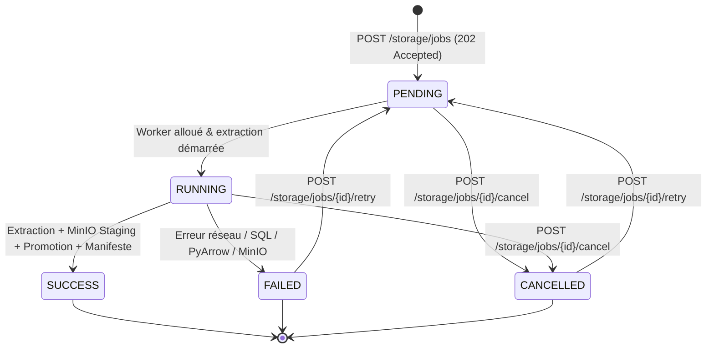

# FinLake Control Plane — Guide et Exemples API REST

**Version** : 1.0  
**Phase** : P5 — API REST & Orchestration des Jobs  
**Date** : 2026-11-18  
**Base URL** : `http://localhost:8000` (ou hôte configuré)  
**OpenAPI / Swagger UI** : `http://localhost:8000/docs`  

---

## 1. Machine à États des Jobs d'Ingestion



---

## 2. Exemples d'Appels `curl` par Endpoint

### 2.1 Santé du Système (`GET /health`)
Vérifie la disponibilité opérationnelle de SQL Server, MinIO et Trino.

```bash
curl -X GET http://localhost:8000/health
```

**Réponse (200 OK) :**
```json
{
  "status": "healthy",
  "services": {
    "sqlserver": "up",
    "minio": "up",
    "trino": "up"
  },
  "timestamp": "2026-11-18T19:40:00.000000Z"
}
```

---

### 2.2 Liste des Sources (`GET /sources`)
```bash
curl -X GET http://localhost:8000/sources
```

**Réponse (200 OK) :**
```json
[
  {
    "id": "sqlserver",
    "type": "relational/sqlserver",
    "database": "finlake_source",
    "host": "127.0.0.1",
    "port": 1433,
    "description": "Microsoft SQL Server 2022 transactional store (PaySim source)."
  }
]
```

---

### 2.3 Test de Connexion d'une Source (`POST /sources/{id}/test`)
```bash
curl -X POST http://localhost:8000/sources/sqlserver/test
```

**Réponse (200 OK) :**
```json
{
  "source_id": "sqlserver",
  "status": "connected",
  "server_version": "Microsoft SQL Server 2022 (RTM-CU14) ...",
  "database": "finlake_source",
  "error": null
}
```

---

### 2.4 Liste des Tables (`GET /sources/{id}/tables`)
```bash
curl -X GET "http://localhost:8000/sources/sqlserver/tables?schema=dbo"
```

**Réponse (200 OK) :**
```json
{
  "source_id": "sqlserver",
  "schema_name": "dbo",
  "tables": [
    "ingestion_jobs",
    "job_runs",
    "transactions"
  ]
}
```

---

### 2.5 Schéma d'une Table (`GET /sources/{id}/tables/{table}/schema`)
```bash
curl -X GET "http://localhost:8000/sources/sqlserver/tables/transactions/schema?schema=dbo"
```

**Réponse (200 OK) :**
```json
{
  "source_id": "sqlserver",
  "schema_name": "dbo",
  "table_name": "transactions",
  "columns": [
    {"name": "ingest_row_id", "type": "BIGINT", "nullable": false},
    {"name": "step", "type": "INT", "nullable": false},
    {"name": "type", "type": "VARCHAR(32)", "nullable": false},
    {"name": "amount", "type": "DECIMAL(19,4)", "nullable": false},
    {"name": "nameOrig", "type": "VARCHAR(64)", "nullable": false},
    {"name": "oldbalanceOrg", "type": "DECIMAL(19,4)", "nullable": false},
    {"name": "newbalanceOrig", "type": "DECIMAL(19,4)", "nullable": false},
    {"name": "nameDest", "type": "VARCHAR(64)", "nullable": false},
    {"name": "oldbalanceDest", "type": "DECIMAL(19,4)", "nullable": false},
    {"name": "newbalanceDest", "type": "DECIMAL(19,4)", "nullable": false},
    {"name": "isFraud", "type": "BIT", "nullable": false},
    {"name": "isFlaggedFraud", "type": "BIT", "nullable": false}
  ]
}
```

---

### 2.6 Création d'un Job d'Ingestion (`POST /storage/jobs`)
Déclenche une extraction asynchrone sans bloquer l'appelant.

```bash
curl -X POST http://localhost:8000/storage/jobs \
  -H "Content-Type: application/json" \
  -d '{
    "source_id": "sqlserver",
    "schema_name": "dbo",
    "table": "transactions",
    "format": "parquet",
    "compression": "snappy",
    "batch_size": 50000,
    "partition_by": ["event_date"]
  }'
```

**Réponse (202 Accepted) :**
```json
{
  "job_id": "job_a1b2c3d4",
  "status": "ACCEPTED",
  "message": "Ingestion job 'job_a1b2c3d4' queued for background processing.",
  "created_at": "2026-11-18T19:40:00.000000Z"
}
```

---

### 2.7 Statut d'un Job (`GET /storage/jobs/{id}`)
```bash
curl -X GET http://localhost:8000/storage/jobs/job_a1b2c3d4
```

**Réponse (200 OK) :**
```json
{
  "job_id": "job_a1b2c3d4",
  "source_id": "sqlserver",
  "schema_name": "dbo",
  "table_name": "transactions",
  "format": "parquet",
  "compression": "snappy",
  "batch_size": 50000,
  "partition_columns": "event_date",
  "status": "SUCCESS",
  "created_at": "2026-11-18T19:40:00Z",
  "updated_at": "2026-11-18T19:40:15Z",
  "latest_run": {
    "run_id": "run_20261118_194000_123456",
    "status": "SUCCESS",
    "total_rows_extracted": 50000,
    "total_bytes_written": 2654320,
    "total_objects_created": 3,
    "manifest_path": "s3://finlake/manifests/paysim/transactions/run_20261118_194000_123456.json",
    "started_at": "2026-11-18T19:40:01Z",
    "completed_at": "2026-11-18T19:40:15Z"
  }
}
```

---

### 2.8 Résultat & Manifeste d'un Job (`GET /storage/jobs/{id}/result`)
```bash
curl -X GET http://localhost:8000/storage/jobs/job_a1b2c3d4/result
```

**Réponse (200 OK) :**
```json
{
  "job_id": "job_a1b2c3d4",
  "run_id": "run_20261118_194000_123456",
  "status": "SUCCESS",
  "total_rows_extracted": 50000,
  "total_bytes_written": 2654320,
  "total_objects_created": 3,
  "manifest_path": "s3://finlake/manifests/paysim/transactions/run_20261118_194000_123456.json",
  "manifest": {
    "job_id": "job_a1b2c3d4",
    "run_id": "run_20261118_194000_123456",
    "format": "parquet",
    "compression": "snappy",
    "row_count_total": 50000,
    "bytes_total": 2654320,
    "objects_count": 3,
    "duration_seconds": 14.25
  },
  "duration_seconds": 14.25,
  "started_at": "2026-11-18T19:40:01Z",
  "completed_at": "2026-11-18T19:40:15Z",
  "error_message": null
}
```

---

### 2.9 Annulation d'un Job (`POST /storage/jobs/{id}/cancel`)
```bash
curl -X POST http://localhost:8000/storage/jobs/job_a1b2c3d4/cancel
```

**Réponse (200 OK) :**
```json
{
  "job_id": "job_a1b2c3d4",
  "status": "CANCELLED",
  "message": "Job 'job_a1b2c3d4' marked as CANCELLED."
}
```

---

### 2.10 Relance d'un Job (`POST /storage/jobs/{id}/retry`)
```bash
curl -X POST http://localhost:8000/storage/jobs/job_a1b2c3d4/retry
```

**Réponse (200 OK) :**
```json
{
  "job_id": "job_a1b2c3d4",
  "status": "ACCEPTED",
  "message": "Job 'job_a1b2c3d4' re-queued for processing."
}
```
