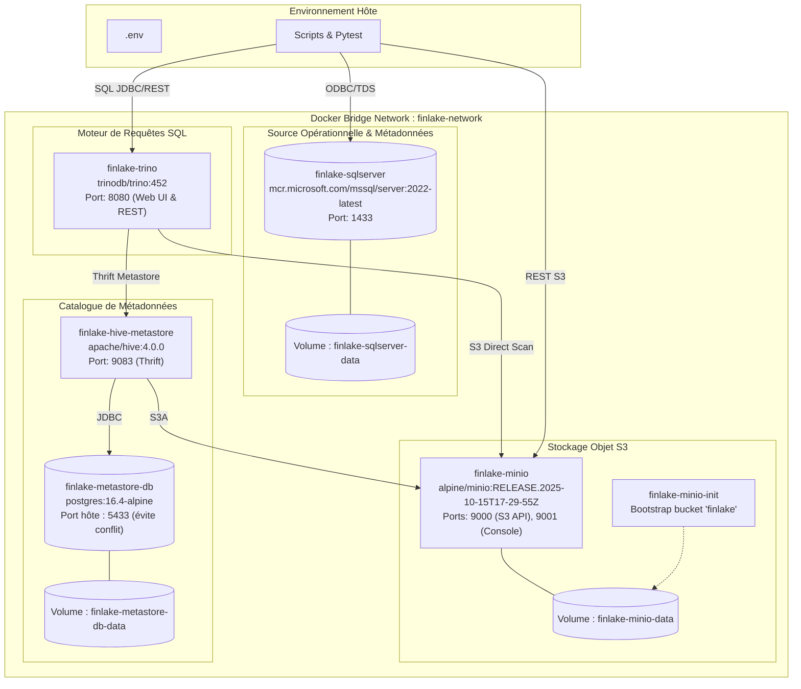

# FinLake — Architecture Technique et Topologie Docker

**Version** : 1.2  
**Phase** : P3 — Moteur d'Ingestion  
**Mise à jour** : 2026-11-18  

---

## 1. Vue d'Ensemble des Composants

FinLake est une plateforme data lake locale conteneurisée bâtie sur une pile open-source robuste :



---

## 2. Rôles et Responsabilités

| Conteneur | Image Figée | Rôle | Ports Exposés | Persistance |
|---|---|---|---|---|
| `finlake-sqlserver` | `mcr.microsoft.com/mssql/server:2022-latest` | Source relationnelle PaySim (`dbo.transactions`) et persistance durable des états de jobs (`dbo.ingestion_jobs`) | 1433 | `finlake-sqlserver-data` |
| `finlake-minio` | `alpine/minio:RELEASE.2025-10-15T17-29-55Z` | Stockage objet compatible S3 pour Parquet, CSV, staging et manifestes | 9000 (API), 9001 (Console) | `finlake-minio-data` |
| `finlake-minio-init` | `alpine/minio:RELEASE.2025-10-15T17-29-55Z` | Conteneur éphémère initialisant l'arborescence des préfixes S3 (`warehouse`, `raw`, `curated`, `staging`, `manifests`) | Aucun | Partagé avec MinIO |
| `finlake-metastore-db` | `postgres:16.4-alpine` | Base relationnelle PostgreSQL pour le schéma Hive Metastore | 5433 (hôte) -> 5432 (conteneur) | `finlake-metastore-db-data` |
| `finlake-hive-metastore` | `apache/hive:4.0.0` | Serveur Hive Metastore Thrift pour le catalogage des tables Parquet externes | 9083 | Stateless (stocké dans PostgreSQL) |
| `finlake-trino` | `trinodb/trino:452` | Moteur de requêtes SQL distribué interrogeant les fichiers MinIO via le catalogue Hive | 8080 | Stateless (catalogue monté en volume) |
| `finlake-backend` | `projet-data-finlake-backend` (Java 21) | Control Plane & Moteur d'Ingestion Natif (Spring Boot 3.3.5, REST API, Auth, Groq AI Copilot) | 8000 | Stateless |
| `finlake-frontend` | `projet-data-finlake-frontend` (Node 20) | Interface utilisateur d'exploration analytique multi-entreprises (Next.js 15, Recharts, Tailwind CSS) | 3000 | Stateless |

---

## 3. Choix Techniques et Arbitrages

### Arbitrage 1 : Port PostgreSQL Metastore (`5433:5432`)
- **Problème détecté** : Le port 5432 était déjà utilisé sur la machine hôte par un conteneur PostgreSQL existant.
- **Solution retenue** : Mappage sur l'hôte en `5433:5432`. En interne sur le réseau `finlake-network`, Hive Metastore continue d'accéder à `metastore-db:5432` de manière transparente et sans conflit.

### Arbitrage 2 : Image MinIO (`alpine/minio:RELEASE.2025-10-15T17-29-55Z`)
- **Problème détecté** : L'image `minio/minio` sur Docker Hub a été restreinte/rendue privée par MinIO Inc.
- **Solution retenue** : Utilisation de l'image publique officielle `alpine/minio` avec un tag de release strict et certifié amont (`RELEASE.2025-10-15T17-29-55Z`), garantissant 100% de reproductibilité sans login.

### Arbitrage 3 : Métadonnées de Jobs sur SQL Server
- **Avantage** : Évite d'ajouter une base SQLite locale fragile ou une base de données supplémentaire dans Compose. SQL Server garantit l'atomicité ACID des transitions d'état des jobs et la persistance au redémarrage des services.

---

## 4. Organisation du Stockage MinIO (`s3://finlake/`)

```text
s3://finlake/
├── raw/
│   └── paysim/transactions/
│       └── ingest_date=YYYY-MM-DD/run_id=<uuid>/
├── curated/
│   └── paysim/transactions/
│       └── event_date=YYYY-MM-DD/*.parquet
├── staging/
│   └── <job_id>/
│       └── *.parquet (fichiers temporaires en cours d'écriture)
├── manifests/
│   └── paysim/transactions/
│       └── <run_id>.json (publié en dernier)
└── warehouse/
    └── (répertoire de base Hive Metastore)
```

---

## 5. Moteur d'Ingestion & Worker (Phase P3)

Le Data Plane est exécuté par le conteneur `finlake-worker:1.0` (Python 3.11 avec PyArrow, PyMSSQL et MinIO SDK) pour isoler les traitements vectoriels et garantir des performances optimales sans dépendre des politiques DLL de l'hôte.

### 5.1 Extraction Bounded-Memory par Keyset Pagination
- **Principe** : Utilisation d'un seek indexé `$O(1)$` sur la clé primaire ordonnée `ingest_row_id` :
  ```sql
  SELECT TOP (@batch_size) ...
  FROM dbo.transactions
  WHERE ingest_row_id > @last_row_id
  ORDER BY ingest_row_id ASC;
  ```
- **Zéro offset** : Pas de `OFFSET ... FETCH NEXT` lourd qui dégrade la mémoire et le temps CPU sur les grandes tables.
- **Mémoire bornée** : Chaque lot (ex: 50 000 lignes) est transformé en `pyarrow.RecordBatch`, sérialisé et immédiatement déchargé vers MinIO sans accumulation en RAM.

### 5.2 Mapping Temporel Synthétique
PaySim simule des pas horaires via `step` (1 à 743). Conformément à la décision d'architecture, la temporalité est rigoureusement typée :
- `event_time_simulated` : Timestamp UTC calculé via `2023-01-01 00:00:00 UTC + (step - 1) heures`.
- `event_date` : Chaîne de date `YYYY-MM-DD` servant de colonne de partitionnement Hive.

### 5.3 Cycle de Vie et Publication Atomique
1. **Initialisation** : Enregistrement de l'état `RUNNING` dans `dbo.job_runs` et `dbo.ingestion_jobs`.
2. **Staging** : Écriture des fichiers Parquet/CSV sous `s3://finlake/staging/{job_id}/{run_id}/`.
3. **Validation d'intégrité** : Calcul des checksums SHA256 et vérification du compte exact de lignes.
4. **Promotion atomique** : Déplacement unitaire des objets de `staging/` vers `s3://finlake/curated/paysim/transactions/event_date=YYYY-MM-DD/`.
5. **Manifeste** : Publication finale du manifeste JSON sous `s3://finlake/manifests/paysim/transactions/{run_id}.json`.
6. **Clôture** : Mise à jour de l'état à `SUCCESS` avec métriques (durée, lignes, octets, objets).

---

## 6. Démarrage, Tests et Exécution

```powershell
# 1. Copier le fichier d'environnement
cp .env.example .env

# 2. Démarrer l'ensemble des services
docker compose up -d

# 3. Vérifier l'état de santé
docker compose ps

# 4. Lancer la suite de validation complète (P0, P1, P2, P3)
python scripts/run_all_tests.py

# 5. Lancer un job d'ingestion Parquet
docker run --rm --network finlake-network -v ${PWD}:/app finlake-worker:1.0 python -m src.finlake.worker.runner --batch-size 50000 --compression snappy
```
