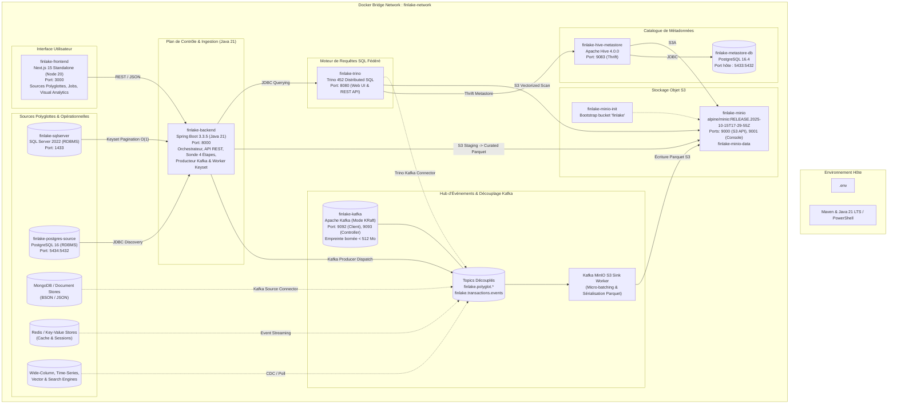

# FinLake — Architecture Technique et Topologie Docker

**Version** : 2.1  
**Phase** : Plateforme Polyglotte Multi-Bases & Hub d'Événements Kafka Sinks  
**Mise à jour** : 2026-11-20  

---

## 1. Vue d'Ensemble des Composants

FinLake est une plateforme de données unifiée locale, entièrement conteneurisée sur Docker Compose. Elle couple un plan de contrôle Java 21 / Spring Boot 3.3.5, une interface Next.js 15, un **hub d'événements Apache Kafka (mode KRaft)** avec **Kafka Sinks**, un stockage objet S3 MinIO, et un moteur de requêtes distribué Trino 452 :



---

## 2. Rôles et Responsabilités des Services

| Conteneur | Image Figée | Rôle | Ports Exposés | Persistance |
|---|---|---|---|---|
| `finlake-sqlserver` | `mcr.microsoft.com/mssql/server:2022-latest` | Source relationnelle PaySim (`dbo.transactions`) et persistance durable des états de jobs (`dbo.ingestion_jobs`) | 1433 | `finlake-sqlserver-data` |
| `finlake-postgres-source` | `postgres:16-alpine` | Source relationnelle secondaire multi-entreprises (`retail_banking`) avec schéma clients et transactions | 5434:5432 | `finlake-postgres-source-data` |
| `finlake-kafka` | `apache/kafka:3.7.0` | Hub de streaming d'événements en mode **KRaft** (sans ZooKeeper), mémoire bornée à 512 Mo de RAM | 9092 (Client), 9093 (KRaft) | `finlake-kafka-data` |
| `finlake-minio` | `alpine/minio:RELEASE.2025-10-15T17-29-55Z` | Stockage objet compatible S3 pour Parquet, CSV, staging et manifestes | 9000 (API), 9001 (Console) | `finlake-minio-data` |
| `finlake-minio-init` | `alpine/minio:RELEASE.2025-10-15T17-29-55Z` | Conteneur éphémère initialisant l'arborescence des préfixes S3 (`warehouse`, `raw`, `curated`, `staging`, `manifests`, `kafka_sink`) | Aucun | Partagé avec MinIO |
| `finlake-metastore-db` | `postgres:16.4-alpine` | Base relationnelle PostgreSQL pour le schéma Hive Metastore | 5433 (hôte) -> 5432 (conteneur) | `finlake-metastore-db-data` |
| `finlake-hive-metastore` | `apache/hive:4.0.0` | Serveur Hive Metastore Thrift pour le catalogage des tables Parquet externes | 9083 | Stateless (stocké dans PostgreSQL) |
| `finlake-trino` | `trinodb/trino:452` | Moteur de requêtes SQL distribué interrogeant les fichiers MinIO via Hive/Iceberg et les flux Kafka temps réel | 8080 | Stateless (catalogue monté en volume) |
| `finlake-backend` | `projet-data-finlake-backend` (Java 21) | Control Plane, API REST, Sonde 4 Étapes, Producteur Kafka et Puits Kafka MinIO S3 Sink | 8000 | Stateless |
| `finlake-frontend` | `projet-data-finlake-frontend` (Node 20) | Interface utilisateur d'exploration analytique multi-entreprises et gestionnaire des connecteurs polyglottes (Next.js 15) | 3000 | Stateless |

---

## 3. Taxonomie des Bases de Données & Rôle des Kafka Sinks

Pour un exposé exhaustif des justifications et compromis architecturaux, se référer au document [docs/context.md](file:///c:/Users/USER/Desktop/projet-data/docs/context.md).

### 3.1 Prise en Charge Universelle des 8 Familles de Bases de Données
FinLake unifie l'ingestion de toutes les familles de bases de données grâce au modèle d'échange découplé :

1. **Relationnelles SQL** (*SQL Server, PostgreSQL, MySQL, Oracle*) : Ingestion directe par Keyset pagination ou streaming CDC vers Kafka.
2. **Documents** (*MongoDB, Couchbase*) : Ingestion des structures BSON/JSON via connecteur source Kafka vers le topic `finlake.polyglot.document.*`.
3. **Clé-Valeur** (*Redis, DynamoDB*) : Ingestion d'états de sessions ou de caches clés-valeurs vers Kafka.
4. **Colonnes Larges** (*Apache Cassandra, ScyllaDB*) : Streaming de partitions larges vers Kafka.
5. **Graphes** (*Neo4j*) : Exportation de nœuds et relations pour analyses de fraude.
6. **Séries Temporelles** (*InfluxDB, TimescaleDB*) : Métriques d'ingestion et débits volumétriques.
7. **Vectorielles** (*Milvus, Qdrant*) : Embeddings pour similarité sémantique et extension IA.
8. **Moteurs de Recherche** (*Elasticsearch, OpenSearch*) : Indexation plein texte des métadonnées du catalogue.
9. **Data Warehouse & Lac Colonnaire** (*MinIO S3 + Parquet + Iceberg + Trino*) : Cible universelle consolidée de l'ensemble des données.

### 3.2 Fonctionnement du Kafka MinIO S3 Sink
Le connecteur puits (**Kafka MinIO S3 Sink**) assure la passerelle entre le monde des flux d'événements en temps réel et le stockage colonnaire analytique :

```
[Topic Kafka: finlake.polyglot.*]
        │
        ▼ (Consommation continue par le Sink Worker)
[Buffer en mémoire : N messages ou fenêtre temporelle de 10s]
        │
        ▼ (Conversion de schéma dynamique vers Parquet)
[Sérialisation Parquet avec compression ZSTD / Snappy]
        │
        ▼ (Dépôt atomique via l'API S3)
[MinIO : s3://finlake/curated/kafka_sink/<domaine>/year=YYYY/month=MM/*.parquet]
        │
        ▼ (Déclaration automatique des partitions)
[Hive Metastore / Apache Iceberg Catalog]
        │
        ▼
[Requêtes analytiques SQL dans Trino]
```

---

## 4. Organisation du Stockage MinIO (`s3://finlake/`)

```text
s3://finlake/
├── raw/
│   └── paysim/transactions/
│       └── ingest_date=YYYY-MM-DD/run_id=<uuid>/
├── curated/
│   ├── paysim/transactions/
│   │   └── event_date=YYYY-MM-DD/*.parquet
│   └── kafka_sink/
│       ├── polyglot_documents/
│       │   └── ingest_date=YYYY-MM-DD/*.parquet
│       └── polyglot_events/
│           └── ingest_date=YYYY-MM-DD/*.parquet
├── staging/
│   └── <job_id>/
│       └── *.parquet (fichiers temporaires en cours d'écriture)
├── manifests/
│   └── paysim/transactions/
│       └── <run_id>.json (publié en dernier)
├── warehouse/
│   └── (répertoire de base Hive Metastore)
└── iceberg/
    └── finlake_iceberg/ (métadonnées et snapshots Apache Iceberg)
```

---

## 5. Moteur d'Ingestion Natif Java 21 & Sonde Multi-Protocoles

Le backend Spring Boot 3.3.5 combine deux canaux d'ingestion complémentaires :

1. **Canal Batch Relational (Keyset Pagination $O(1)$)** :
   * Idéal pour les extractions massives planifiées de sources relationnelles (ex: 6,36 millions de lignes PaySim).
   * Maintient une empreinte mémoire constante sans jamais déborder la JVM.
2. **Canal Streaming Polyglotte (Kafka Sinks)** :
   * Idéal pour n'importe quelle source NoSQL, Document, Clé-Valeur ou flux d'événements.
   * Découple entièrement la vitesse de production de la vitesse d'écriture dans le stockage objet.

### Sonde Réseau et Découverte en 4 Étapes
Chaque source (SQL, NoSQL, Kafka) est validée par la sonde `SourceExplorerService` :
1. **Étape 1 : Joindre le serveur** (Vérification Socket TCP / handshake initial).
2. **Étape 2 : Sécuriser la connexion** (Validation TLS/SSL, certificats mutuels).
3. **Étape 3 : S'authentifier** (Validation des identifiants utilisateur ou tokens de sécurité).
4. **Étape 4 : Ouvrir le catalogue/schéma** (Découverte en direct des collections ou tables disponibles).
