# FinLake — Guide du Module Data Sources & Spécifications Wireframe

**Version** : 1.0  
**Date** : 2026-11-20  
**Spécification de référence** : `Data Platform — Wireframe.pdf`  
**Statut** : 100% Implémenté & Vérifié  

---

## 1. Vue d'Ensemble

Le module **Data Sources** permet aux organisations de connecter, tester en direct, explorer et enregistrer leurs bases de données relationnelles (Microsoft SQL Server et PostgreSQL) dans la plateforme FinLake.

Il respecte scrupuleusement l'ergonomie, les statuts, les codes d'erreur et les parcours utilisateurs définis dans les 7 pages du document de référence `Data Platform — Wireframe.pdf`.

```
┌─────────────────────────────────────────────────────────────────────────────┐
│                          Data Sources Dashboard (/sources)                  │
│   [Toutes: 7]  [Connectées: 5]  [En échec: 1]  [Non testées: 1]  [🔍 Search]│
└──────────────────────────────────────┬──────────────────────────────────────┘
                                       │ "+ Ajouter une source"
                                       ▼
┌─────────────────────────────────────────────────────────────────────────────┐
│                    Ajouter une connexion (/sources/new)                     │
│  [⚡ Démo SQL Server 2022]                      [⚡ Démo PostgreSQL 16]      │
├──────────────────────────────────────┬──────────────────────────────────────┤
│ FORMULAIRE DE CONNEXION              │ TESTEUR INTERACTIF EN DIRECT (4 ÉTAPES)│
│ 1. Connexion (Moteur, Nom)           │ 1. Joindre le serveur (Socket TCP)   │
│ 2. Serveur (Hôte, Port, Base)        │ 2. Sécuriser la connexion (TLS/SSL)  │
│ 3. Authentification (User, Password) │ 3. S'authentifier (Identifiants)     │
│ 4. Paramètres avancés (Timeout, SSL) │ 4. Ouvrir la base (Tables réelles)   │
└──────────────────────────────────────┴──────────────────────────────────────┘
```

---

## 2. Correspondance Page par Page avec le Wireframe

| Page Wireframe | Intitulé / Rôle | Implémentation FinLake | Fonctionnalités Clés |
| :--- | :--- | :--- | :--- |
| **Page 1** | Liste des sources de données | `frontend/src/app/sources/page.tsx` | Onglets de filtrage (`Toutes`, `Connectées`, `En échec`, `Non testées`), recherche instantanée, badges de statut, horodatages humanisés, bouton `⚡ Tester` et bouton `Explorer`. |
| **Page 2** | Formulaire d'ajout (État non testé) | `frontend/src/app/sources/new/page.tsx` | Formulaire en 4 sections (Connexion, Serveur, Authentification, Paramètres avancés). Panneau latéral affichant l'état d'attente *"Pas encore testée"*. |
| **Page 3** | Test de connexion en cours | `frontend/src/app/sources/new/page.tsx` | Stepper interactif animé, chronomètre des secondes écoulées en direct (`0.8 s`), étape active en rotation et bouton *"Annuler le test"*. |
| **Page 4** | Connexion réussie | `frontend/src/app/sources/new/page.tsx` | 4 étapes validées en vert (`✓ Réussi`), version exacte du serveur (`Microsoft SQL Server 2022` ou `PostgreSQL 16`), temps de réponse en millisecondes et **Preuve de connexion active**. |
| **Page 5** | Échec de connexion & Diagnostic | `frontend/src/app/sources/new/page.tsx` | Bannière d'alerte, étape défaillante surlignée en rose (ex: Étape 3 `S'authentifier`), détails techniques précis (Erreur `18456` SQL Server ou `28P01` PostgreSQL), et checklist de vérification (*"À vérifier"*). |
| **Page 6** | État vide : Aucune source | `frontend/src/app/sources/page.tsx` | Rendu lorsque le registre est vide : icône centrale, message explicatif et bouton CTA direct `+ Ajouter une source`. |
| **Page 7** | État vide : Aucun résultat de recherche | `frontend/src/app/sources/page.tsx` | Rendu lorsqu'une recherche textuelle ne retourne aucune source : message *"Aucun résultat pour « [query] »"* et bouton pour effacer la recherche. |

---

## 3. Architecture de la Sonde de Connectivité en 4 Étapes

Le backend Spring Boot exécute une sonde modulaire et synchrone via l'endpoint `POST /sources/probe` :

```mermaid
sequenceDiagram
    autonumber
    actor User as Utilisateur (UI)
    participant API as Spring Boot (SourceExplorerService)
    participant Network as Couche Réseau (Socket)
    participant DB as SGBD (SQL Server / PostgreSQL)

    User->>API: POST /sources/probe (Paramètres de connexion)
    
    rect rgb(20, 30, 50)
        Note over API,Network: Étape 1 : Joindre le serveur
        API->>Network: Socket.connect(host, port, timeout)
        Network-->>API: Socket connectée (OK)
    end

    rect rgb(20, 40, 50)
        Note over API,DB: Étape 2 : Sécuriser la connexion
        API->>DB: Négociation TLS/SSL (encrypt=true / sslmode=prefer)
        DB-->>API: Handshake TLS validé
    end

    rect rgb(20, 50, 40)
        Note over API,DB: Étape 3 : S'authentifier
        API->>DB: DriverManager.getConnection(url, user, pass)
        alt Identifiants invalides
            DB-->>API: SQL Server 18456 / Postgres 28P01
            API-->>User: Échec Étape 3 + Checklist de dépannage
        else Identifiants valides
            DB-->>API: Session JDBC établie
        end
    end

    rect rgb(30, 50, 30)
        Note over API,DB: Étape 4 : Ouvrir la base & Découverte live
        API->>DB: SELECT @@VERSION, DB_NAME() / SELECT version(), current_database()
        API->>DB: SELECT table_name FROM information_schema.tables LIMIT 6
        DB-->>API: Version du moteur + Tables réelles détectées
        API-->>User: 4 étapes réussies + Version + discovered_tables
    end
```



---

## 4. Moteurs Pris en Charge

FinLake supporte nativement deux moteurs relationnels conteneurisés sous Docker :

### 4.1 Microsoft SQL Server 2022
- **Conteneur** : `finlake-sqlserver`
- **Port interne / hôte** : `1433`
- **Base par défaut** : `finlake_source`
- **Utilisateur par défaut** : `sa`
- **Schéma par défaut** : `dbo`
- **Code d'erreur d'authentification** : `18456`

### 4.2 PostgreSQL 16
- **Conteneur** : `finlake-postgres-source`
- **Port interne** : `5432` / **Port hôte** : `5434`
- **Base par défaut** : `retail_banking`
- **Utilisateur par défaut** : `finlake_user`
- **Schéma par défaut** : `public`
- **Code d'erreur d'authentification** : `28P01`
- **Tables de démonstration pré-chargées** : `retail_customers` (3 lignes), `retail_transactions` (4 lignes)

---

## 5. Démonstration en Direct (Mode Démo en 1 Clic)

Pour faciliter les démonstrations en appel sans saisie manuelle de mot de passe :

1. Ouvrir [`http://localhost:3000/sources/new`](http://localhost:3000/sources/new).
2. Cliquer sur **`⚡ Démo PostgreSQL 16`** ou **`⚡ Démo SQL Server 2022`** dans le bandeau supérieur.
3. Observer l'injection immédiate de tous les champs et le déroulement du test live (~250-350 ms).
4. La carte **Preuve de connexion active** affiche les tables réelles découvertes (`retail_customers`, `retail_transactions`).
5. Cliquer sur **`Enregistrer la connexion`** pour finaliser l'enregistrement et retrouver la source active dans [`/sources`](http://localhost:3000/sources).
6. Cliquer sur **`Explorer`** pour inspecter les colonnes, types et compteurs de lignes réels dans le tiroir latéral.
